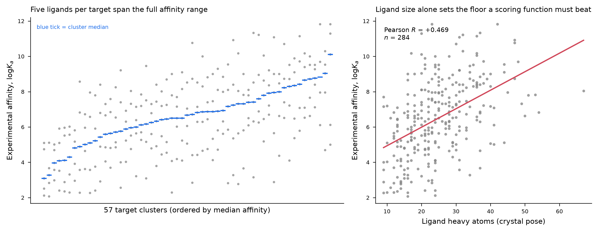

# CASF-2016 도킹·스코어링 벤치마크 — 1단계 보고

작성: 2026-10-16 · 데이터셋 확정 및 기준선 수립 단계

## 1. 목적과 평가 축

단백질–저분자 복합체 285개로 구성된 CASF-2016 코어셋에서 도킹·스코어링 성능을 측정한다.
CASF 설계의 핵심은 **스코어링 과정을 도킹 과정에서 분리**해 네 가지 능력을 따로 측정하는 데 있다 —
scoring power, ranking power, docking power, screening power.[^casf2016]
본 작업은 이 중 처음 세 가지를 대상으로 한다.

| 평가 축 | 측정 대상 | 결정 구조만으로 가능한가 |
|---|---|---|
| Scoring power | 예측 점수와 실험 logKa의 상관 | 가능 (결정 포즈 사용) |
| Ranking power | 같은 타깃의 리간드 5개 순위 재현 | 가능 |
| Docking power | 재도킹 포즈가 결정 포즈를 2 Å 이내 복원 | **불가 — 도킹 엔진 필요** |

평가 지표의 조작적 정의는 CASF-2013 프로토콜 논문의 절차를 따른다.[^nprot]
벤치마크 계보는 2009년 초판[^casf2009] → CASF-2013[^casf2013] → CASF-2016[^casf2016]이며,
기반 데이터는 PDBbind 데이터베이스다.[^pdbbind]

## 2. 데이터셋 (확정)

| 항목 | 값 |
|---|---|
| 복합체 수 | 285 |
| 타깃 클러스터 | 57개 × 리간드 5개 (모든 클러스터가 정확히 5개) |
| 실험 결합세기 logKa | 2.07 – 11.82 (평균 6.49, 표준편차 2.17) |
| 측정 유형 | Ki 178건 / Kd 107건 |
| 결정 해상도 | 1.10 – 2.50 Å |
| 등록 연도 | 1989 – 2015 |

왼쪽 패널은 57개 클러스터의 logKa 분포(파란 눈금 = 클러스터 중앙값), 오른쪽은 리간드 크기 기준선이다.

## 3. 구조 확보와 리간드 식별

285개 mmCIF 전부를 RCSB에서 내려받았다(189.3 MB, 실패 0건).
wwPDB 공식 아카이브(`files.wwpdb.org`)는 이 환경의 허용 목록 밖이지만 RCSB가 동일 아카이브를 제공하므로 대체했다.

PDBbind의 리간드 지정 파일이 없으므로 리간드를 구조에서 직접 식별했다. 절차는 다음과 같다.

1. mmCIF의 `_atom_site`에서 HETATM 그룹을 (체인, 잔기번호, 화합물 ID)로 묶는다.
2. 물·이온·결정화 첨가제를 제외하고, 중원자 6개 미만 그룹을 버린다.
3. `_chem_comp.type`이 펩타이드/당/핵산 결합형인 성분(즉 고분자 사슬의 수식 잔기)을 제외한다.
4. 남은 후보 중 중원자 수가 가장 많은 것을 선택하고, 동수면 단백질 접촉 원자 수로 가린다.
5. RCSB가 결합친화도 주석으로 리간드 화합물 ID를 제공하는 엔트리는 그 값을 우선한다.

**검증:** RCSB 주석이 존재하는 50개 엔트리에서 휴리스틱 단독 결과와 비교해 **49/50 일치**했다.
3단계(`_chem_comp.type` 필터)를 넣기 전에는 48/50이었고, 불일치는 공유결합된 수식 아미노산(LLP, TYS)을
리간드로 잘못 고른 경우였다.

| 리간드 출처 | 엔트리 수 |
|---|---|
| RCSB 결합친화도 주석 | 49 |
| `_chem_comp.type` 필터 휴리스틱 | 229 |
| 최대 HETATM 휴리스틱 (지방산 리간드 등) | 5 |
| 주석-휴리스틱 불일치, 휴리스틱 채택 (3syr) | 1 |
| **미해결** (1a30, 리간드가 펩타이드 사슬) | 1 |

결합부위 탐색 상자는 선택된 리간드의 좌표 범위에 각 축 +10 Å 여유를 준 크기로 정의했다 —
중앙값 17.2 × 17.1 × 17.0 Å, 최대 변 30.1 Å. 285개 전체 표는 [casf2016_core_index.csv](./casf2016_core_index.csv).

육안 확인용 대표 구조: [3o9i (최강, Ki 1.5 pM)](https://www.rcsb.org/structure/3O9I) · [4kzu (중앙값, Ki 313 nM)](https://www.rcsb.org/structure/4KZU) · [3ao4 (최약, Kd 8.5 mM)](https://www.rcsb.org/structure/3AO4).

## 4. 실행 환경 제약 (확정)

이 머신은 네이티브 Windows(16코어 / 28 GiB / GPU 없음)이고 연결된 원격 컴퓨트 대상은 없다.
AutoDock Vina[^vina][^vina12]는 PyPI에 manylinux·musllinux 휠만 배포되며, 설치를 직접 시도한 결과
`No matching distribution found for vina`로 실패했다. Vinardo[^vinardo] 등 Vina 계열 스코어링 함수도
같은 바이너리에 의존한다. 따라서 **docking power(재도킹 포즈 복원)는 현재 환경에서 실행 불가**이며,
리눅스 원격 컴퓨트 연결이 전제 조건이다.

도킹 포즈를 얻은 뒤에는 RMSD 성공률만으로 충분하지 않다 — 물리적으로 불가능한 포즈가 성공으로 집계되는
문제가 보고되어 있으므로 PoseBusters 류의 타당성 검사를 함께 적용한다.[^posebusters]

## 5. 지금 확보한 수치: 기준선 (널 모델)

결정 구조 포즈만으로 계산 가능한 자명한 특징이 실험 결합세기를 얼마나 설명하는지 측정했다.
스코어링 함수가 이 값을 넘지 못하면 "상호작용을 이해한다"고 말할 수 없는 바닥선이다 (n = 284).

| 특징 | Pearson R | Spearman ρ | 타깃 내 평균 Spearman |
|---|---|---|---|
| 리간드 중원자 수 | **+0.469** (p = 5.8×10⁻¹⁷) | +0.493 | +0.557 (56개 클러스터) |
| 단백질 접촉 원자 수 (4.5 Å) | +0.464 (p = 1.3×10⁻¹⁶) | +0.470 | +0.521 (57개 클러스터) |
| 접촉 수 / 중원자 수 | −0.092 (p = 0.12) | −0.103 | −0.136 |
| 결정 해상도 (대조군) | +0.173 | — | — |

해석: 리간드 크기 하나로 scoring power R ≈ 0.47, ranking power(타깃 내 평균 ρ) ≈ 0.56이 나온다.
접촉 밀도(접촉 수를 크기로 나눈 값)는 유의하지 않아, 설명력이 크기 자체에서 오고 접촉의 질에서 오지 않음을 보여준다.
결정 해상도가 logKa와 약하게 양의 상관을 보이는 것은 강한 결합자가 더 좋은 결정을 주는 경향에서 오는
교란 변수이며, 성능 수치 해석 시 유의해야 한다.

## 6. 다음 단계

1. 리눅스 원격 컴퓨트 연결 → AutoDock Vina 1.2.x 설치 → 285개 재도킹(네이티브 리간드 중심 상자, exhaustiveness 8 이상).
2. 대칭 보정 RMSD로 docking power 산출(2 Å 성공률) + PoseBusters 타당성 검사.
3. Vina / Vinardo 점수의 scoring power·ranking power를 위 기준선과 함께 제시.
4. 1a30(펩타이드 리간드)은 별도 처리하거나 제외하고 그 사실을 명시.

## 참고문헌

모든 DOI는 Crossref에서 확인했고(10/10 해석 성공) 제목은 PubMed 기록과 정규화 후 일치했다.
검증 표: [reference_check.csv](./reference_check.csv).

[^casf2016]: Su M. et al. *Comparative Assessment of Scoring Functions: The CASF-2016 Update.* Journal of Chemical Information and Modeling (2018), DOI [10.1021/acs.jcim.8b00545](https://doi.org/10.1021/acs.jcim.8b00545)
[^casf2013]: Li Y. et al. *Comparative assessment of scoring functions on an updated benchmark: 1. Compilation of the test set.* Journal of Chemical Information and Modeling (2014), DOI [10.1021/ci500080q](https://doi.org/10.1021/ci500080q)
[^casf2009]: Cheng T. et al. *Comparative assessment of scoring functions on a diverse test set.* Journal of Chemical Information and Modeling (2009), DOI [10.1021/ci9000053](https://doi.org/10.1021/ci9000053)
[^nprot]: Su M. et al. *Assessing protein–ligand interaction scoring functions with the CASF-2013 benchmark.* Nature Protocols (2018), DOI [10.1038/nprot.2017.114](https://doi.org/10.1038/nprot.2017.114)
[^pdbbind]: Wang R. et al. *The PDBbind Database: Collection of Binding Affinities for Protein–Ligand Complexes with Known Three-Dimensional Structures.* Journal of Medicinal Chemistry (2004), DOI [10.1021/jm030580l](https://doi.org/10.1021/jm030580l)
[^vina]: Trott O., Olson A. J. *AutoDock Vina: improving the speed and accuracy of docking with a new scoring function, efficient optimization, and multithreading.* Journal of Computational Chemistry (2009), DOI [10.1002/jcc.21334](https://doi.org/10.1002/jcc.21334)
[^vina12]: Eberhardt J. et al. *AutoDock Vina 1.2.0: New Docking Methods, Expanded Force Field, and Python Bindings.* Journal of Chemical Information and Modeling (2021), DOI [10.1021/acs.jcim.1c00203](https://doi.org/10.1021/acs.jcim.1c00203)
[^vinardo]: Quiroga R., Villarreal M. A. *Vinardo: A Scoring Function Based on AutoDock Vina Improves Scoring, Docking, and Virtual Screening.* PLOS ONE (2016), DOI [10.1371/journal.pone.0155183](https://doi.org/10.1371/journal.pone.0155183)
[^posebusters]: Buttenschoen M. et al. *PoseBusters: AI-based docking methods fail to generate physically valid poses or generalise to novel sequences.* Chemical Science (2024), DOI [10.1039/d3sc04185a](https://doi.org/10.1039/d3sc04185a)

문헌 메타데이터는 PubMed에서 조회했다. 추가 배경: Liu Z. et al. *Forging the Basis for Developing Protein–Ligand Interaction Scoring Functions*, Accounts of Chemical Research (2017), DOI [10.1021/acs.accounts.6b00491](https://doi.org/10.1021/acs.accounts.6b00491).
